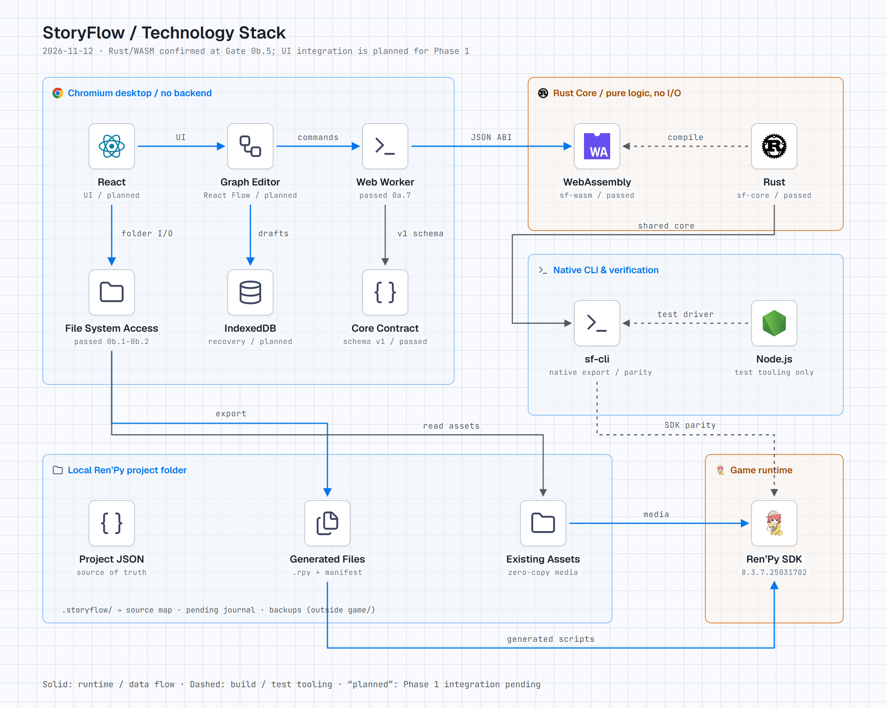
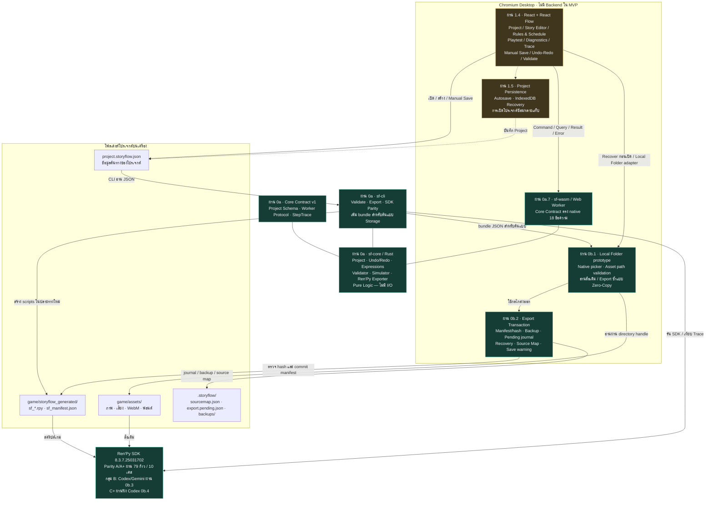
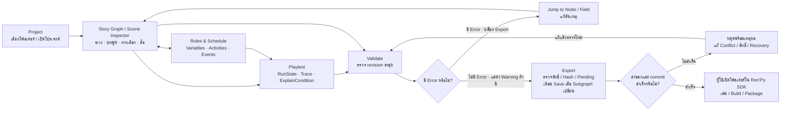

# StoryFlow Game Studio

StoryFlow คือเว็บสตูดิโอสำหรับผู้สร้างเกมเดี่ยวและทีมเล็ก ใช้กราฟวางฉาก บทสนทนา คลิป และตัวเลือกสำหรับเกม Visual Novel, FMV, Dating Sim และ Life Sim แล้วส่งออกเป็นโปรเจกต์ที่เล่นใน Ren’Py SDK ได้

**สถานะล่าสุด (2026-11-14):** 1.1–1.5 ตรวจรับร่วมแล้ว; มี Autosave, IndexedDB Recovery และ Web Locks แล้ว พร้อมเริ่มพัฒนา 1.6 (Export UI) ดู [checklist](checklist.md) และ [ผล 1.5](document/phase-1/recovery-1.5.md)

รันหน้าจอด้วย `npm --prefix studio ci` แล้ว `npm --prefix studio run dev` หลัง build WASM ตาม [วิธีรัน Studio](studio/README.md)

## ขั้นตอนใช้งานที่วางแผนไว้สำหรับ MVP

1. เปิดหรือสร้างโปรเจกต์ในโฟลเดอร์บนเครื่องผ่าน Chrome หรือ Edge
2. จัดฉากและเชื่อมทางเลือกบน Story Graph เพิ่มตัวแปร เงื่อนไข และกิจกรรมรายวันตามที่เกมต้องใช้
3. ทดลองเล่นจากฉากที่เลือก ดูค่าที่เปลี่ยนและเหตุผลที่ตัวเลือกหรือเหตุการณ์ปลดล็อก
4. ตรวจปัญหาแล้วส่งออกสคริปต์ไปยัง `game/storyflow_generated/` จากนั้นเปิดเกมใน Ren’Py SDK การส่งออกซ้ำใช้สื่อเดิมใน `game/assets/`

## แนวทางระบบและข้อกำหนดเบื้องต้น

- **เบราว์เซอร์ที่รองรับ (MVP):** เบราว์เซอร์สาย Chromium บนเดสก์ท็อป (Google Chrome / Microsoft Edge) ที่รองรับ File System Access API
- **เอนจินเป้าหมายและมาตรฐานสื่อ:** ตรึง **Ren’Py SDK `8.3.7.25031702`** สำหรับ Phase 0a ใช้ Windows Desktop Session สำหรับการทดสอบ Parity ตามข้อตกลง 0a.1 และใช้คลิป `.webm` (`VP9 + Opus`)
- **หน้าจอ (Frontend):** ใช้ React และ React Flow สื่อสารกับ Core ผ่านสัญญาข้อมูลและคำสั่งที่ใช้ร่วมกัน (`Core Contract`)
- **แกนหลัก (Core):** เริ่มด้วย Rust/WASM (`sf-core`) ใน Web Worker และใช้ CLI (`sf-cli`) ทดสอบผลจำลองเทียบกับ Ren’Py ด้วยเดโม Summer House
- **ไฟล์โปรเจกต์และการสำรองข้อมูล:** เก็บในโฟลเดอร์บนเครื่องเป็น `project.storyflow.json` พร้อม Autosave, ร่างกู้คืนใน IndexedDB และระบบส่งออกแบบ Transactional Export โดยใช้เว็บแบบไม่มี Backend

## Technology Stack



[ภาพ Dark](document/diagrams/storyflow-stack-dark.png) · [HTML แบบเปิดออฟไลน์](document/diagrams/storyflow-stack.html) · [ที่มาและวิธีปรับภาพ](document/diagrams/README.md)

React/React Flow เชื่อม Worker แล้วใน 1.1; IndexedDB/Autosave/Web Locks เชื่อมแล้วใน1.5 ส่วน Export UI เป็นขั้นถัดไป ส่วน Rust/WASM, Core Contract และ Local Folder/Transaction ผ่านขั้นพิสูจน์ต้นแบบแล้ว Node.js ใช้ build frontend และทดสอบ ไม่ใช่ Backend; เจ้าของยืนยันใช้ Rust/WASM ต่อแล้วตามมติ 0b.5

เส้นทึบแสดงความสัมพันธ์ runtime/data รวมส่วนที่ติดป้าย planned เส้นประแสดงการ build/test ดูรายละเอียดพฤติกรรมและสถานะใน Architecture ด้านล่าง

## สถาปัตยกรรมและสถานะปัจจุบัน

สถานะในกรอบ: **ผ่าน** = ตรวจรับแล้ว, **ต้นแบบ** = มีโค้ดแต่ยังไม่ปิดตรวจรับขั้นนั้น, **แผน** = ยังไม่พัฒนาเป็น MVP ครบวงจร เส้นประแสดงการเชื่อมต่อในแผน สีเป็นตัวช่วยอ่านและมีข้อความสถานะกำกับเสมอ



Core สร้างเนื้อหาสคริปต์และ Source Map; CLI/Storage เป็นผู้ทำ I/O ส่วน manifest/hash, journal และ backup อยู่ใน Storage prototype ภาษา Core และเกณฑ์ประสิทธิภาพยืนยันแล้วตาม [มติ 0b.5](document/phase-0b/decision-gate-0b5.md) แผนภาพนี้ไม่เพิ่ม scope ของ Phase

### Workflow ของ Web Studio MVP

แผนภาพนี้แสดงพฤติกรรมเป้าหมายของหน้าจอ Phase 1 อ้างอิง [DESIGN.md](DESIGN.md) และ [mockup](document/demo%20screen/Workflow-Screens.md) ปัจจุบันตรวจรับเฉพาะ Core และ Local Folder ตามสถานะข้างต้น



การทดลองเล่นและการตรวจปัญหาเรียกใช้ซ้ำระหว่างแก้เรื่องได้ ไม่บังคับเดินครบทุกหน้าตามลำดับทุกครั้ง หน้าเว็บแนะนำการเปิด SDK ต่อ ไม่ได้เรียกโปรแกรมบนเครื่องให้เอง

### ส่วนประกอบหลักของระบบ

| ชั้นสถาปัตยกรรม | โมดูล / เทคโนโลยี | หน้าที่ความรับผิดชอบ |
|---|---|---|
| **1. Frontend UI** | React + React Flow | แสดงผลและแก้ไขกราฟเนื้อเรื่อง (`Story Graph`), ฟอร์มฉากและกติกา (`Inspector` / `Rules & Schedule`), หน้าจำลองการเล่น (`Playtest`), รายการปัญหา (`Validate`) และหน้าส่งออก (`Export`) โดยพรีวิวสื่อจาก `game/assets/` โดยตรง |
| **2. Core Contract** | JSON Schema (`schemaVersion: 1`) + Worker Protocol (`contractVersion: 1`) | สัญญากลางสำหรับรับ–ส่ง `Command` (แก้ไขข้อมูลพร้อม Undo/Redo), `Query`, `Result`, `Error` และ `StepTrace` ระหว่าง UI, Web Worker และ CLI |
| **3. Core Engine (`sf-core`)** | Rust (คอมไพล์เป็น `sf-wasm` และ `sf-cli`) แบบไม่มี I/O ตรง | - **`model` & `commands`:** โครงสร้างข้อมูลโปรเจกต์, การแปลง UUID เป็น `sf_<kind>_<shortId>`, ระบบ `Undo`/`Redo` และตรวจรุ่น Schema (v1 เป็นรุ่นแรก ยังไม่มี migration จากรุ่นก่อนหน้า)<br>- **`expr`:** ประเมินเงื่อนไข AST (`all`, `any`, `not`, `compare`) และคำนวณค่า `int` ใน `i64` แล้ว Clamp ลงช่วง `i32` และ `[min, max]` หลังทุกคำสั่ง<br>- **`validate`:** ตรวจสอบความถูกต้องของโหนด 5 ชนิด, พอร์ตบังคับ, กฎ Subgraph, กิจกรรมสำรอง และพาธสื่อ<br>- **`sim`:** จำลองการเล่นบน `RunState` แยกจากโปรเจกต์ พร้อม `StepTrace`, `ExplainCondition`, `SetVar`/`Rewind` และ Loop Guard<br>- **Exporter และ Storage:** สร้างโค้ด `.rpy` แบบ Deterministic, ทำ Literal Escaping, สร้าง `sf_manifest.json` (SHA-256) และ `sourcemap.json` |
| **4. Storage & Transactional Export** | File System Access API + IndexedDB + Web Locks API | บันทึก `project.storyflow.json` แบบ Atomic Write พร้อม Autosave (~2 วินาที), เก็บร่างกู้คืนใน IndexedDB ผูกกับ Project ID/revision, ล็อกการเปิดซ้อนหลายแท็บ และส่งออกไฟล์ `.rpy` แบบ Transaction ที่กู้คืนชุดเดิมได้อัตโนมัติเมื่อเกิดเหตุขัดข้อง |

## โครงสร้างโฟลเดอร์โปรเจกต์ (Zero-Copy Media)

StoryFlow ทำงานบนโฟลเดอร์โปรเจกต์เดียวกับ Ren’Py โดยอ่านและพรีวิวสื่อจาก `game/assets/` โดยตรง ไม่คัดลอกไฟล์สื่อซ้ำเมื่อส่งออก:

```text
<ProjectRoot>/
├── project.storyflow.json          # ไฟล์ต้นทางของโปรเจกต์ StoryFlow (Single Source of Truth)
├── .storyflow/                     # ข้อมูลระบบ (sourcemap.json, export.pending.json, backups/)
└── game/
    ├── script.rpy                  # ไฟล์เริ่มต้นของ Ren'Py (เรียกเข้า label sf_entry)
    ├── assets/                     # ไฟล์สื่อทั้งหมด (bg/, chars/, video/, audio/, fonts/)
    └── storyflow_generated/        # ไฟล์ .rpy ที่ StoryFlow สร้างอัตโนมัติ (ห้ามแก้ด้วยมือ)
        ├── sf_manifest.json
        ├── sf_runtime.rpy
        ├── sf_variables.rpy
        ├── sf_story.rpy
        └── sf_schedule.rpy
```

## สถานะและแผนพัฒนา

### ใช้งานและตรวจรับแล้ว

- **Phase 0a ครบ 0a.0–0a.7 และ Gate:** Core Contract v1, Rust Core, Validator, Simulator, Undo/Redo, Exporter/CLI และ WASM Worker
- **Parity A/A+:** Core กับ Ren’Py SDK ตรงกัน 79 ก้าวใน 10 เคสย่อย; Worker เทียบ native ผ่าน 18 ข้อความ
- **Phase 0b.1:** เลือกโฟลเดอร์จริงผ่าน File System Access API อ่านสื่อใต้ `game/assets/` ปฏิเสธพาธต้องห้าม และ Export ซ้ำโดยสื่อเดิมคง hash/size/lastModified รายงาน native-folder ผ่าน 10/10 checks

### มีต้นแบบ แต่ยังไม่ตรวจรับครบ

- **0b.2 ตรวจรับผ่าน Codex/Gemini:** Transactional Export, manifest/hash, staged files/backup, pending journal, Source Map และ Save warning ดู [หลักฐาน](document/phase-0b/transaction-0b2.md)
- **0b.3 ตรวจรับผ่าน Codex/Gemini:** แก้ BUG-0b-001 แล้ว มีเทมเพลตฟอนต์ Noto Thai พร้อม TCC wrapping, literal ครบ 5 บริบท และคลิป VP9+Opus บน SDK จริง ดู [หลักฐาน](document/phase-0b/media-0b3.md)
- **0b.4 ตรวจรับผ่าน Codex/Gemini:** ปิด page/context จริง, native permission หาย/regrant แล้วกู้ hashes ทั้ง 8 รายการตรง baseline และกู้ซ้ำปลอดภัย ดู [หลักฐาน](document/phase-0b/recovery-0b4.md)
- **0b.5 เจ้าของยืนยันแล้ว:** Rust/WASM และเกณฑ์ P1–P8 ตาม [มติ](document/phase-0b/decision-gate-0b5.md); Gate 0b ผ่านร่วม Codex/Gemini แล้ว ดู [สรุป Gate](document/phase-0b/gate-0b.md)

ผล native 10/10 เป็น baseline 0b.1; รอบ 0b.2 เพิ่ม filesystem regression 18/18 และ Edge OPFS 10/10 ไม่ใช้แทนการตรวจปิดแท็บ/สิทธิ์จริงใน 0b.4

### หน้าจอและมาตรฐาน Design

React + React Flow UI ทั้ง Project, Story Graph/Scene Inspector, Rules & Schedule, Playtest, Validate และ Export อยู่ใน Phase 1 ปัจจุบันมีภาพ mockup และ [DESIGN.md](DESIGN.md) เป็นแนวทางร่วม ยังไม่ใช่หน้าจอใช้งานครบวงจร

ขั้น 1.2 เปิด/สร้างโปรเจกต์ในโฟลเดอร์ บันทึก manual จัดการตัวละคร/สื่อ แก้กราฟ5ชนิดและ Inspector/ข้อความบนกราฟได้ ใช้ Core Patch และ Undo/Redo ชุดเดียวกัน ตัวอย่างยังอยู่ใน memory ตำแหน่งโหนดยังไม่บันทึกข้าม session ดู [วิธีรัน](studio/README.md) และ [ภาพ/ผลตรวจ 1.2](document/phase-1/editor-1.2.md) ภาษาไทยเป็นหลัก คงศัพท์เทคนิคอังกฤษ

ขั้น 1.3 เพิ่ม Variables/Condition Builder/Effects และ Activities/Events/Schedule แล้ว สร้างกติกา Summer House จาก UI ได้ตรง fixture และผ่าน Worker/native 10เคส/79ก้าว ดู [ผล 1.3](document/phase-1/rules-1.3.md)

ขั้น 1.4 เพิ่ม Playtest/Diagnostics: เริ่มจากโหนดที่เลือก, SetVar/Rewind, ExplainCondition, StepTrace JSON และเปิดโหนดจากผลตรวจ โดย RunState แยกจาก Project ดู [ผลและข้อจำกัด 1.4](document/phase-1/playtest-1.4.md)

ขั้น1.5เพิ่มAutosave~2วินาที, ร่างIndexedDBตามProjectID/source revision, WebLocksกันแท็บซ้อน และกู้conflictเป็นสำเนาแล้ว ดู [ผล1.5](document/phase-1/recovery-1.5.md)

Export UI ยังอยู่ในแผน MVP; ไม่มี Backend ในขอบเขตนี้

### Baseline ที่ใช้ตัดสินใจต่อ

กราฟอ้างอิง 2,000 โหนดบน Edge/Windows: เปิด 215.5 ms, Validate 29.7 ms, applyEdit 73.5 ms; WASM Brotli 669,601 bytes ตัวเลข Worker ไม่รวมการวาดกราฟหรือพรีวิวสื่อ ผลรุ่นปัจจุบันและเป้าที่เจ้าของยืนยันแล้วดูใน [มติ 0b.5](document/phase-0b/decision-gate-0b5.md): open 79.2 ms, Validate 19 ms, applyEdit 36.7 ms, Brotli 670,237 bytes; applyEdit ใช้เกณฑ์ median ≤100 ms แทน 16 ms ชั่วคราว

Native prototype รอบ 0b.1 วัด Export ซ้ำได้ 3,661.5 ms ส่วนรอบ 0b.2 วัดแก้หนึ่งฉาก → CLI bundle → filesystem export commit ได้ 950.8164 ms เป็น sample เดียวบน Node handle adapter คนละวิธีกับ browser native ไม่ใช้เทียบตรงหรือรับรอง SLA ของ MVP

### ทดสอบ Core และ CLI

ต้องมี Rust, Cargo และ linker ที่ตรง target พร้อม dependency ตาม `Cargo.lock` เครื่องอ้างอิงใช้ Rust `1.99.1` (`x86_64-pc-windows-gnu`) และ LLVM-MinGW; ดูสภาพแวดล้อมในเอกสาร Phase 0a

```powershell
cargo test --workspace --locked
cargo run -p sf-cli --locked -- validate contract/fixtures/summer-house.json
cargo run -p sf-cli --locked -- export contract/fixtures/summer-house.json temp/readme-export-new
```

คำสั่ง `export` ของ CLI ใช้ปลายทางใหม่ที่ยังไม่มีอยู่ จัดสื่อจริงใน `game/assets/` ก่อนรันเกมบน SDK ตัว CLI นี้แยกจาก native-folder prototype และยังไม่ใช่หน้า Export UI

ผล Rust ในหลักฐาน 0a.5 ผ่าน 12 เทสต์; การตรวจ Parity, Worker และ Local Folder มีหลักฐานแยกตามลิงก์ด้านล่าง รอบ1.4ผ่าน build/unit13, Edge E2E9กลุ่ม และ regression1.1–1.3 ตามหลักฐานด้านบน

| Phase | สถานะ / เป้าหมาย |
|---|---|
| **0a** | ตรวจรับผ่านครบ: Contract, Core, SDK Parity, WASM/Worker และ baseline |
| **0b** | 0b.1–0b.5 และ Gate ตรวจรับผ่านร่วม Codex/Gemini ครบแล้ว |
| **1** | 1.1–1.4 ตรวจรับร่วมแล้ว; 1.5 พัฒนาเสร็จรอ Gemini; 1.6–1.7 และ Gate ยังไม่เสร็จ |
| **2** | ยังไม่เริ่ม: ความทนทานและ User Trial |
| **3** | รอยืนยันขอบเขตตามผลทดลอง เช่น Cloud Sync, PWA, Localization |

## เอกสารโครงการ

- [Concept v2 (`StoryFlow-Game-Studio-Concept.md`)](StoryFlow-Game-Studio-Concept.md) — ขอบเขต กติกาเกม สถาปัตยกรรม และเกณฑ์ตรวจรับ
- [Checklist กลาง (`checklist.md`)](checklist.md) — ลำดับงาน สถานะพัฒนา ผลตรวจรับ และหลักฐาน
- [Core Contract](contract/README.md) — JSON Schema, Worker Protocol และ fixtures ของ Summer House
- [Parity 0a.6](document/phase-0a/parity-0a6.md) และ [Worker baseline 0a.7](document/phase-0a/worker-0a7.md) — ผลพิสูจน์ Core/SDK และ Worker
- [Native Folder 0b.1](document/phase-0b/evidence/native-report.json) — รายงานตรวจรับโฟลเดอร์จริง
- [Trace spike](document/phase-0a/trace-spike.md) และ [ข้อตัดสินใจ 0a.1](document/phase-0a/decisions-0a1.md) — หลักฐานทดสอบและสภาพแวดล้อมอ้างอิง
- [ภาพตัวอย่างหน้าจอและลำดับการใช้งาน (`document/demo screen/Workflow-Screens.md`)](document/demo%20screen/Workflow-Screens.md) — ต้นแบบหน้าจอทั้ง 6 ขั้นตอนสำหรับ Phase 1
- **ไฟล์ข้อตกลงและบันทึกการทำงานในเครื่องพัฒนา** *(อยู่ใน `.gitignore` ไม่รวมใน Git สาธารณะ)*: `AGENTS.md`, `gemini.md`, `gpt.md`, `claud.md`

- [มาตรฐาน Design กลาง (DESIGN.md)](DESIGN.md) — กติกา UI จาก mockup สำหรับพัฒนาและตรวจรับ Phase 1


- [ภาษาไทยและสื่อจริง 0b.3](document/phase-0b/media-0b3.md) และ [เทมเพลตเกมใหม่](templates/renpy/README.md) — Literal, ฟอนต์, TCC wrapping และ VP9+Opus
